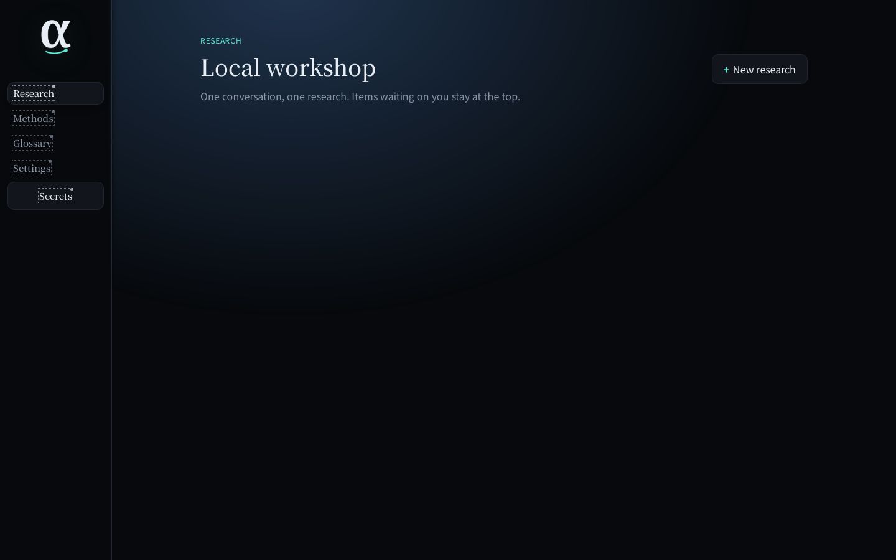
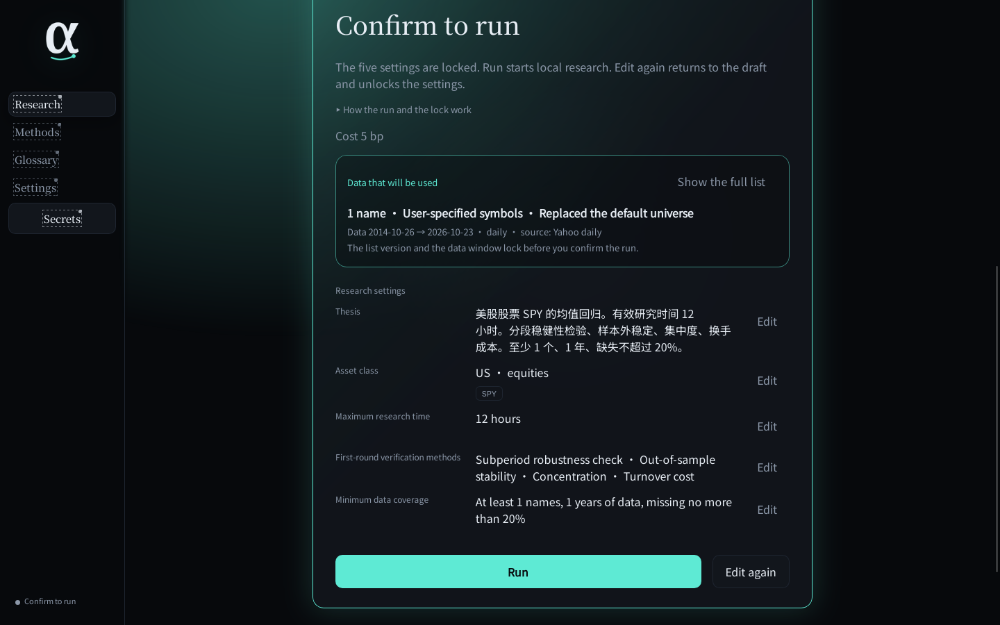
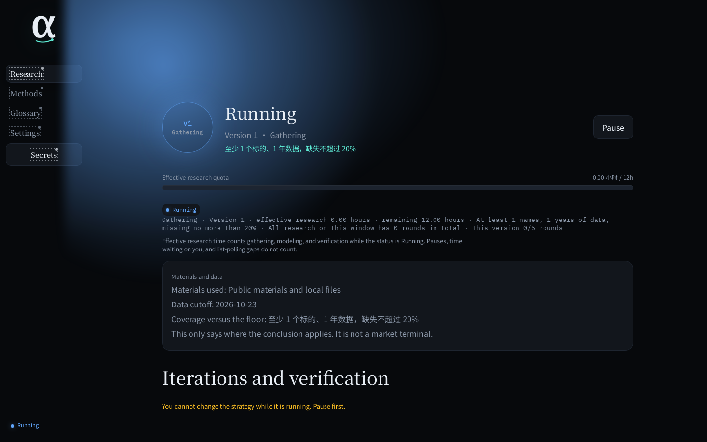
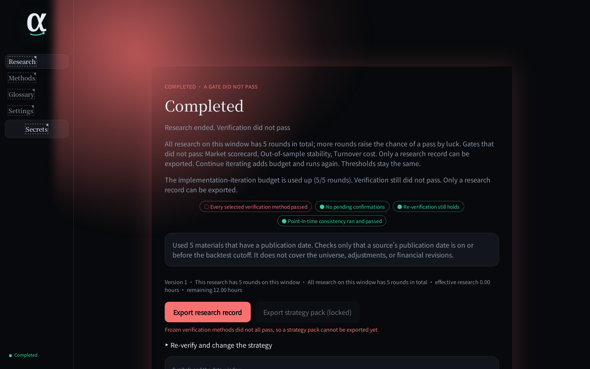
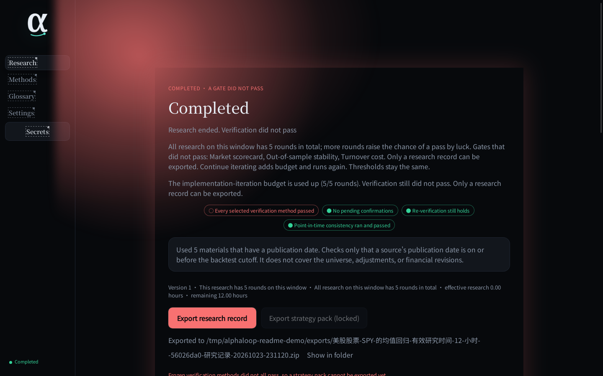

English | [简体中文](README.zh-CN.md)

# alphaloop

AlphaLoop 0.2.0 runs one daily equity mean-reversion study on your own machine and writes the gate results into a file you can take away. Automatic iteration defaults to at most 5 rounds. That cap can be changed, and after it is spent you can confirm more rounds. It does not send orders, and it does not decide whether you should use the strategy.

With several names, the signal is a cross-sectional z-score of recent returns. With one name, it uses that name's own rolling standard deviation. Fills use the previous bar's signal. Automatic iteration only adds 5 to the lookback. The default list is membership on the list date, not membership at the time, so earlier history carries survivorship bias. The point-in-time check does not look at that. A pass does not mean the bias was ruled out.

It is for someone who already runs daily backtests and wants those rounds and the failed checks in a file. It does not sweep parameters, and it does not replace a tool that sends orders or runs other strategies.

There is no installer, no hosted service, and no paid plan. The CLI only shows that the engine process is up. A study runs in the desktop app, and the desktop app needs a packaged engine first.

The English UI shows strategy-family ids as stored, for example `mean_reversion`. The same page in Chinese is [README.zh-CN.md](README.zh-CN.md). The two files are edited together. Nothing checks them against each other automatically.

## One concrete job

The question is whether stocks that fell recently move back toward a recent mean.

A common approach is to score closes in a notebook, try a few lookback windows, and keep the best equity line. Three things usually go wrong. The signal and the fill use the same bar's close. The number of trials is not in any file. The result stays on someone else's site, and what you take away is a chart rather than the verifier definitions that produced it.

In alphaloop the dialogue locks five settings: the economic thesis, the universe, a cap on effective research time, the first-round verifiers, and a minimum data-coverage floor. Pauses and time spent waiting for confirmation do not count toward that cap. If the thesis says momentum, trend, or breakout, the confirm card and the completed screen say that is not supported. The engine still runs only mean reversion. After you confirm, signals are computed and then shifted by one bar before the weights are applied. The first round starts at a lookback of 20 days, an entry z of 1.0, and long-only. The default automatic budget is 5 rounds. The automatic change adds 5 to the lookback, and that 5 is hardcoded, not an environment variable. A change of economic logic stops and waits.

A strategy pack is exported only when all five of these hold: the study is completed; every frozen verifier on the current round passed; nothing is waiting for confirmation; every reverification of the current round other than point-in-time passed (if none of those were recorded, this check passes); and the point-in-time check ran and passed. Point-in-time uses the original round, not a later reverification of that check. It only checks whether a cited source's publication date is on or before the backtest cutoff. Undated material is dropped and does not fail the check. A study can pass it while citing no external material. It does not check whether the universe was the membership at the time, whether prices were adjusted, or whether financials were restated. Survivorship bias does not fail this check, so a point-in-time pass is not a clean bill for the list. Otherwise the export is a research record. `why_not_live.json` lists the failed check names, and `manifest.json` sets `live_handoff_eligible` to false. The backtest in the pack is a historical hypothesis, not live performance and not a forecast.

There is no measured time saving. The visible change is that the trial count and the failed gates stay in the record.

## What works, and what does not

**Works**

- Lock the five settings in the desktop app and run a historical study. The default reviewer is deterministic and does not call a model. An external model is used only when `ALPHALOOP_REVIEWER=subagent` and `ALPHALOOP_LLM_BASE_URL`, `ALPHALOOP_LLM_API_KEY`, and `ALPHALOOP_LLM_MODEL` are all set. If any of those is missing, the review fails closed.
- With no tickers typed, a new study uses a generated-date list shipped in the repo. US: `us_equity_large_cap_v2`, S&P 500 constituents as of 2026-10-16, 503 names. China A-shares: `cn_equity_large_cap_v2`, CSI 300 constituents as of 2026-10-19, 300 names. Studies that already point at v1 keep those 40-name lists. Typed tickers replace the default pool.
- Those lists are membership on the list date, not point-in-time membership. The pool file says the list is membership on the generation date, not point-in-time membership, and that earlier history carries survivorship bias. The on-screen note says the list is not point-in-time, for example "Taken from S&P 500 membership on the list date; not point-in-time." The spec asks records to store `survivorship_bias_untested`. The 0.2.0 exporter does not write that key.
- Export a research record. Export a strategy pack only when the five checks pass. Whoever receives the pack implements execution. alphaloop does not connect to a broker.

**Not done, or not safe to treat as done**

- No orders, no broker, no paper-trading session. The CLI can only start the engine and show status.
- Low volatility, stock-bond rebalance, fundamental factor, and all-weather have ids and Chinese display names. Starting one returns "这一族还不能开跑。" (this family cannot be run yet).
- Local CSV import, vendor data connectors, and the data-source and model pages in Settings are still the later page. The settings page that works is interface language: follow the system, Chinese, or English.
- The product spec says Yahoo and AkShare must be labeled unlicensed, and that a study cannot start until you acknowledge that. Version 0.2.0 pins `yahoo_daily` or `akshare_sina_daily` from the symbols. The UI says "雅虎日线" and "AkShare 日线（新浪优先）". The confirm flow does not ask for that acknowledgement. The word "未经许可" is in the UI language glossary JSON, not in [`docs/GLOSSARY.md`](./docs/GLOSSARY.md). Starting a run requests those sources. On an institutional network, judge the terms yourself. The label on screen is not a data license.
- The spec also names an export check `coverage_satisfied`. `strategy_pack_eligibility` has no such key. Coverage can stop a run while it is going; it is not one of the keys in that function.
- Undated material is not treated as point-in-time evidence. The scope of the check is in the export conditions above.
- There is no citable user count, customer, or track record. On 2026-10-23 the public repository had no GitHub Release, discussions were disabled, and there were no open issues.

## Fastest path

Python 3.12 and Git. The desktop app also needs Node.js 22, Rust, and a system webview. The typecheck workflow uses Node 22. The macOS packaging workflow says Node 20; desktop tests were not re-run on Node 20 here. On Linux, CI installs `libwebkit2gtk-4.1-dev` and the related packages. Building the engine sidecar also needs the `python3.12-venv` package: on 2026-10-23, `scripts/build_sidecar.sh` exited 1 on a machine without it, because the virtual environment had no ensurepip. On that date, `https://pypi.org/pypi/alphaloop/json` returned 404. The package is not on PyPI.

```bash
git clone https://github.com/AlphaStrategyAI/alphaloop.git
cd alphaloop
python3 -m pip install -e ".[dev]"
python3 -m apps.cli.main start
python3 -m apps.cli.main status
```

After `start`, `status` prints one JSON line. This is one Linux run from 2026-10-23. The pid changes every time:

```json
{"awaiting_confirm": false, "has_running_research": false, "owner": "cli", "pid": 11699, "running": true}
```

That means the engine process is up. The CLI cannot create a study, confirm it, or export it. There is no `stop` subcommand. Stop the pid shown by `status`.

A study runs in the desktop app, which first needs a packaged engine sidecar. The build creates `.venv-sidecar` and runs PyInstaller. How long it takes depends on the machine and the network:

```bash
bash scripts/build_sidecar.sh
python3 scripts/stage_sidecar.py --target linux --source dist/alphaloop-engine --tauri-root apps/desktop/src-tauri
bash scripts/smoke_sidecar.sh
cd apps/desktop
npm ci
npm run tauri dev
```

Use `--target macos` or `--target windows` on those systems. On 2026-10-23, after `python3.12-venv` was installed, that build finished and `smoke_sidecar.sh` printed `engine handshake ok: ready`.

If the CLI was already started, stop that pid before the desktop app. They share the same runtime lock by default.

In the app, create a study under Research. The dialogue asks for the five settings. One message can fill more than one of them. With no tickers typed, the default pool is 503 or 300 names, and the planned window is 12×365 days back from today's UTC date. Starting the run downloads daily bars and needs a network. If the download fails or coverage falls through the floor you accepted, the study stops and says why. It does not switch to a price file that is not in the repository.

### One desktop run, 2026-10-23

This was a maintainer test on Linux, not a customer result and not a license from Yahoo. The window text was English. The UI had no 「未经许可」 checkbox to tick. The code still pinned Yahoo daily and the test clicked Run. The export path on the last screenshot is `/tmp/alphaloop-readme-demo/exports/…`. That directory was `ALPHALOOP_DATA_ROOT` for this process, not the default `~/.local/share` path.

The dialogue message was: `美股股票 SPY 的均值回归。有效研究时间 12 小时。分段稳健性检验、样本外稳定、集中度、换手成本。至少 1 个、1 年、缺失不超过 20%。` The confirm card showed one name, SPY, replacing the default universe, source `Yahoo daily`, 2014-10-26 to 2026-10-23, and cost 5 bp. The message said 股票, so the card classified it as US equities and used the 5 bp equity rate, not the 1 bp fund rate. The shell clock at the click was 15:06:47Z. The research row's `updated_at` was 15:06:54Z. The completed screen shows effective research time `0.00` hours because those seconds do not fill a hundredth of an hour. The zip name ends in `20261023-231120`, which is 15:11:20Z shown in UTC+8, the export click, not the finish time. The completed screen shows five rounds on this window and a 5/5 budget. The stored study, which the screenshots do not print, ended at lookback 40 and kept entry z 1.0 and long-only.

The completed screen said a gate did not pass. The empty circle beside "Every selected verification method passed" is the failed state. Market scorecard, out-of-sample stability, and turnover cost did not pass. The market scorecard was not one of the four methods in the dialogue; the screen still listed it. Subperiod robustness and concentration did pass. The green "Re-verification still holds" chip was lit even though this run stored no reverification; an empty list passes that check. Point-in-time consistency ran and passed. The on-screen scope line said the check only compares a source's publication date with the backtest cutoff, and does not cover the universe, adjustments, or financial revisions. The same screen said five materials had a publication date. The files written under `materials/` are Crossref hits titled, in short, an herbal-extraction paper, a switched-systems paper, two femoral-fracture papers, and a 1984 InSb-film paper. They are not a review of this strategy. The strategy pack stayed locked. Export wrote a research record. The zip's `manifest.json` has `live_handoff_eligible: false`. `why_not_live.json` lists `all_current_methods_passed`. Those two files are not visible in the screenshot; the screenshot shows the locked pack and the export path. These numbers are this one run. They are not a performance claim.











Checks that do not hit the market:

```bash
python3 -m pytest -q -m "not network"
cd apps/desktop && npm test
```

One pytest item is a Rust contract test. CI plants an empty engine placeholder before running it. Without that placeholder and without the GTK development packages, that one test fails. The other offline tests do not need it.

On Linux, data defaults to `~/.local/share/ai.alphastrategy.alphaloop` (`research.db`, `materials/`, `exports/`, `snapshots/`, `engine.log`). The lock and `owner.json` use `platformdirs` `user_runtime_path("alphaloop")`. With no `XDG_RUNTIME_DIR`, it uses `/run/user/<uid>` when that directory is usable, and only otherwise a temp `runtime-<uid>/alphaloop`. Override either root with `ALPHALOOP_DATA_ROOT` or `ALPHALOOP_RUNTIME_ROOT`.

## What to trust, and what not to

What you can check is the repository, the license, and a local run. There is no third-party audit and no performance case study.

The MIT copyright line is `Copyright (c) 2026 AlphaStrategyAI`. The MIT text allows use, modification, and redistribution of this code, including commercial use, if the copyright and license notice are kept. It does not warranty the software, and it does not grant rights to market, filing, or index data. There is no contributor license agreement.

US daily bars go through [yfinance](https://github.com/ranaroussi/yfinance). That project's README says it is not affiliated with Yahoo, is meant for research and education, and tells you to read Yahoo's terms yourself. A-share daily bars go through [AkShare](https://github.com/akfamily/akshare), Sina first, Eastmoney if Sina fails. AkShare's README says the data is for academic research, is not investment advice, and that some interfaces may be removed. Either source can fail or change. The product spec wants both labeled unlicensed. As written above, the 0.2.0 UI does not do that yet.

Papers are fetched from Crossref. Issuer filings are fetched from SEC EDGAR with a fixed User-Agent: `alphaloop/0.2 research@example.invalid`. That is not your contact address, and it should not be used as an institution's contact. No live EDGAR request was sent here, so this page does not claim that identity is accepted. Local Markdown belongs in the data directory's `materials/`.

Equity bars are requested adjusted: yfinance uses `auto_adjust=True` for US names, and AkShare uses forward-adjusted `qfq` for A-shares. The equity benchmark is still a price index. The US id `SPX` is fetched as `^GSPC`. `000300.SH` is fetched as an index series. Percentage changes of adjusted prices are not the same measure as a price index.

Confirming a new run sets the cost model to `schedule_v1`. Net backtest returns are charged on turnover: 5 bp one way for US equities, 1 bp for US funds, 20 bp for A-share equities, 5 bp for A-share funds. A 5% single-name weight cap applies when at least 20 names can be held and the book is not a fund and not long/short. The turnover gate is a second calculation: 10 bp for the US and 20 bp for A-shares, subtracted from annualized excess as annualized turnover times bp/10000. When the return series is already net of `schedule_v1`, the gate still subtracts again. This is arithmetic, not a backtest: if annualized turnover equals 1, the US gate subtracts another 0.001. Do not add the 5 bp in the backtest to the 10 bp in the gate and call the sum 15 bp. The glossary sentence that says the return series itself has no daily costs describes the older `legacy_zero` path. An old A-share record reverified from a frozen snapshot stays on that path. The A-share completed screen says that T+1 and price limits are not simulated, so real fills can be worse. The confirm card shows the cost line, not that sentence. An A-share result here is not a judgment of real fills.

Rounds on the same data window accumulate in SQLite and in exported `history/rounds.json`. The window key includes the confirmation date, so opening the same idea the next day starts a new window and the count does not come along. A larger count does not loosen a threshold. After the default budget is spent, every further round needs your confirmation. Once the count is at or above 20, every further round needs the extra confirmation, not only the round that crosses 20. The round budget defaults to 5, and the added budget after it is spent also defaults to 5. Adding 5 to the lookback is a separate hardcoded number. It is not controlled by the added-budget variable. The three defaults live in `engine/research/honest_stop.py` and can be changed with `ALPHALOOP_MAX_TRIALS`, `ALPHALOOP_TRIAL_BUDGET_INCREMENT`, and `ALPHALOOP_HIGH_SUSPICION_ROUNDS`.

An unusual result is a checklist of the indicators that fired. The labels are "Sharpe ratio is unusually high versus the baseline", "Data coverage has shrunk since the start", and "The number of trials is unusually high versus the baseline". It does not expand the provenance. The "verifier definition changed recently" indicator is not set on the completed screen: that view passes 30 days, and the trigger is an age under 7.

## Compared with what people already use

Checked against documents retrieved on 2026-10-23. Pages that did not open are not turned into numbers.

| Approach | What it actually offers | What it does not do for you |
| --- | --- | --- |
| Your own Python or a spreadsheet | It runs exactly the code you wrote. Look-ahead is yours to avoid. | Their docs do not show a trial ledger like the one here, and there is no shared export gate. |
| [vectorbt](https://github.com/polakowo/vectorbt) | Large parameter sweeps on your machine. The README separates the community edition from paid VectorBT PRO. The license is Apache 2.0 with the Commons Clause. | A sweep does not record how many combinations you threw away. |
| [zipline-reloaded](https://github.com/stefan-jansen/zipline-reloaded) 3.2.0 (2026-10-18) | Event-driven backtests, Apache 2.0. Maintainers limit the project to bug and compatibility fixes and point new work at ML4T Backtest. Release 3.2 does not support pandas 3. | Not a research record with an export gate. |
| [backtrader](https://github.com/mementum/backtrader) 1.9.78.123 | An event-driven framework, GPLv3+. That PyPI release is dated 2023-04-19. Broker integrations are in the library. | Upstream releases stop at that version. It is a trading framework, not a trial ledger. |
| [JoinQuant](https://www.joinquant.com/) | Research, backtest, and paper trading in the browser. The official API document says that querying fundamentals by reporting period can introduce future data, and that `use_real_price` defaults to false. | The study lives on their servers. The membership charge page returned 403 on 2026-10-23, so no price is stated. |
| [RiceQuant](https://www.ricequant.com/doc/quant/) | Browser research on RQData. The docs' basic tier has no paper-trading slots; the enterprise tier does. Their PDF says the trial account lasts one month. | Formal data prices are via sales. A forum quote is not used here. |
| [LEAN](https://github.com/QuantConnect/Lean) | The engine is Apache 2.0 and can run locally. QuantConnect's cloud is a separate subscription that includes live trading. | No currency figure from the pricing page was verified, so none is quoted. The product includes order routing. |
| [Qlib](https://github.com/microsoft/qlib) | Microsoft's MIT platform for data, model training, and backtesting. `pip install pyqlib` still leaves data preparation to you. | It is a model pipeline. It does not answer how many rounds this study tried or which gate failed. |

Stay with those tools when you need minute or tick bars, a broker, low-volatility, stock-bond, fundamental, or all-weather research, or fundamentals someone else maintains. Version 0.2.0 does none of that. If the job is to sweep many parameters and keep the highest Sharpe, vectorbt does that sweep. alphaloop does not.

## License, money, and participation

There is no paid tier, no paid support, and no hosted instance. On 2026-10-23 there is no development task to pick up, and the gaps between the spec and the code are not a call for patches. Discussions are disabled. There is no second channel, no `CONTRIBUTING` file, and no contributor license agreement.

If behavior disagrees with this file, open an [issue](https://github.com/AlphaStrategyAI/alphaloop/issues). Include the date, the command, and the JSON from `status`. If the issue is an export, name the failed check. Do not change the mean-reversion path that already runs in order to implement low volatility, stock-bond rebalance, fundamental factor, all-weather, the unlicensed acknowledgement, `coverage_satisfied`, or translated family names. The [V1 cut line](./docs/requirements/v1-cut-line.md) both says that shipped path is not rewritten by later specs and still contains sentences the code does not implement, including an export check named `coverage_satisfied` and an unlicensed label on screen. Do not turn those two sentences into one task. The code and this file win.

The desktop has a secret vault. It prefers the system keychain. Without one, the choice is this session only, or a local file encrypted with a passphrase. The settings page cannot yet turn those secrets into a usable data source. Do not put a secret in an issue.

## Known limits

- The default automatic budget is 5 rounds. If a design mock shows more, the code is what runs. Adding 5 to the lookback and granting 5 more rounds are not the same switch.
- The data-window key includes the confirmation date. Opening the same idea the next day starts a new window, and the cumulative count does not carry over.
- Automatic iteration does not search the entry threshold and does not change family. With one name, the z-score is not a cross-section.
- "分段稳健性检验" splits an already computed return series in time. It is not a walk-forward that refits parameters. "集中度" is position weight, not market crowding. The old phrases still parse in the dialogue.
- The 5 bp inside the backtest and the 10 bp inside the gate are not the same cost. See the two cost layers above.
- `pyproject.toml` does not pin dependency versions. The install on 2026-10-23 resolved pandas 3.1.0, yfinance 1.7.0, and akshare 1.19.3. Another day can resolve differently.
- On that date `npm audit` reported 2 moderate and 2 high issues in dev dependencies, and 0 with `--omit=dev`. That is not a security audit.

## Docs

- [V1 cut line](./docs/requirements/v1-cut-line.md): what this version promises. Read this first.
- [Product positioning](./docs/requirements/product-positioning.md): what the product is meant to become. It is wider than 0.2.0 and is not a feature list.
- [Glossary](./docs/GLOSSARY.md)
- [Settings spec](./docs/requirements/settings-config-v1.md): a spec, not a finished settings UI.
- [Path contract](./docs/requirements/paths-contract.md)

## License

MIT. Full text in [`LICENSE`](./LICENSE).
