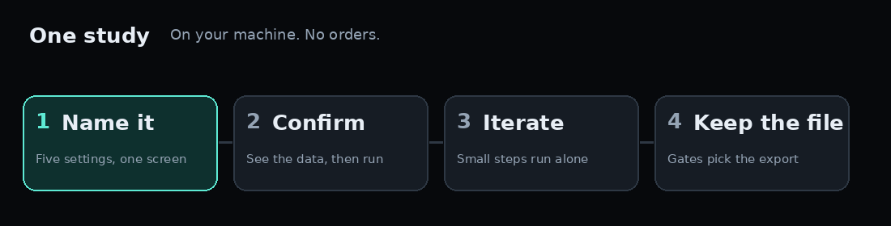
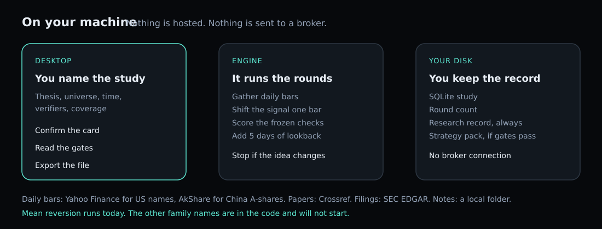
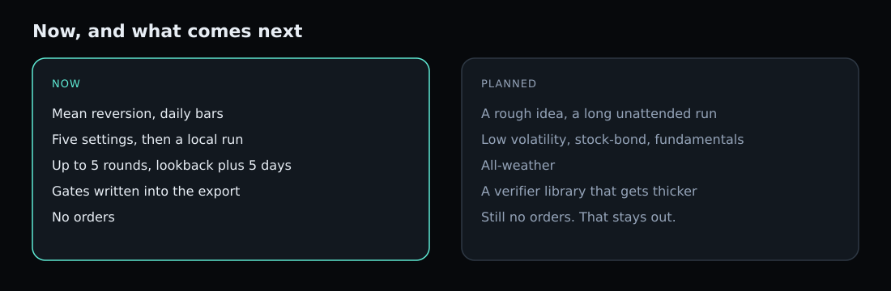

English | [简体中文](README.zh-CN.md)

# alphaloop

A local workshop for a daily equity idea. You describe the study. AlphaLoop runs it on your machine and keeps a file of every round and every failed check. It does not send orders.

Today that study is mean reversion. You confirm the card, the engine iterates, and you leave with either a strategy pack or a research record that says why the pack stayed locked.




## Start

Python 3.12, Git, Node.js 22, Rust, and a system webview. Building the engine also needs `python3.12-venv`. There is no installer, and the package is not on PyPI.

```bash
git clone https://github.com/AlphaStrategyAI/alphaloop.git
cd alphaloop
python3 -m pip install -e ".[dev]"
bash scripts/build_sidecar.sh
python3 scripts/stage_sidecar.py --target linux --source dist/alphaloop-engine --tauri-root apps/desktop/src-tauri
cd apps/desktop && npm ci && npm run tauri dev
```

Use `--target macos` or `--target windows` on those systems. On Linux, install WebKitGTK 4.1 before the desktop build. Open a study from **New research**. The command line only starts the engine and prints status. Stop it before the desktop app if both would share the same lock.

## What you get

- **The work stays on your computer.** The study, the snapshots, and the export live in a local folder. There is no account and no hosted service.
- **You see the trade before it runs.** The confirm card shows the names, the window, the data source, and the cost. US equities are 5 bp one way, US funds 1 bp, China A-share equities 20 bp, A-share funds 5 bp.
- **The fill is the previous bar.** The signal is scored, then shifted one bar before the weights. You do not trade the same close you just measured.
- **Small changes continue. A new idea waits.** Up to five rounds run on their own. Each one adds five days to the lookback, starting from 20 days, entry z of 1.0, long only. If the economic logic changes, the run stops for you.
- **The file remembers the tries.** The round count is stored and exported. More rounds do not loosen a gate.
- **A strategy pack is earned.** It exports only when the study is finished, the frozen checks passed, nothing is waiting, and the point-in-time check ran and passed. Otherwise you still get a research record that names the failed check. The backtest inside is a historical hypothesis, not a forecast and not a live result.

Default lists ship with the app: S&P 500 names and CSI 300 names, each taken on the day the list was built (503 and 300 names). That is not membership at the time. History before that day carries survivorship bias, and the screen says so. Type tickers and the list is replaced. A single name uses its own rolling dispersion. Several names use a cross-section.


## What a finished study looks like

A real mean-reversion run on one US name can end like this. Three checks failed. Point-in-time passed. The strategy pack stayed locked, and the export was a research record.

The empty circle beside "Every selected verification method passed" means that check failed. The green re-verification chip can be on even when nothing was re-checked. An empty list passes. The market scorecard runs even if you did not name it.


Point-in-time only asks whether a cited source was published by the end of the backtest. Undated notes are dropped. They do not fail the check, and a study can pass with no outside evidence. The check does not cover who was in the index, how prices were adjusted, or restated financials. A pass does not clear survivorship bias.

The five dated sources in that run were keyword hits from a paper index, not a review of the strategy. That is why a point-in-time pass is not a reading list.

## How it is put together



You work in the desktop app. The engine collects daily bars, simulates, and scores a frozen set of checks. Everything it keeps is under your data folder. On Linux that is `~/.local/share/ai.alphastrategy.alphaloop`, unless you set `ALPHALOOP_DATA_ROOT`.

Daily bars come from Yahoo Finance for US names and AkShare for China A-shares. Papers come from Crossref. Filings come from SEC EDGAR. Your own notes are a local folder. These feeds are unofficial or limited to research use. The app selects them for you and does not yet ask you to acknowledge that. The name on the card is not a data license.

## Now, and next



**Now.** Mean reversion on daily US and China A-share names. Five settings, a local run, a round count, and an export that fails closed.

**Planned, not running.** A rougher idea left to work for a long time. Low volatility, stock and bond rebalance, fundamental factors, and all-weather. A verifier library that grows from study to study. Momentum is not offered in the meantime, and it is not quietly replaced by mean reversion. Orders stay out of the product. The direction is written in [product positioning](docs/requirements/product-positioning.md). What ships now is spelled out in the [delivery note](docs/requirements/v1-cut-line.md).

## When to use something else

Use AlphaLoop when you want a daily equity study with a trial ledger on your own machine.

Use something else when you need a broker, a paper account, or minute and tick bars. Use a sweep library such as [vectorbt](https://github.com/polakowo/vectorbt) when you want to try a large grid of parameters. Use a hosted desk such as [JoinQuant](https://www.joinquant.com/) or [RiceQuant](https://www.ricequant.com/doc/quant/) when the research should live in the browser. Use [zipline-reloaded](https://github.com/stefan-jansen/zipline-reloaded), [backtrader](https://github.com/mementum/backtrader), [LEAN](https://github.com/QuantConnect/Lean), or [Qlib](https://github.com/microsoft/qlib) when you want to extend a backtest engine or a model pipeline in code.

## Before you trust a figure

Adjusted prices are not the same thing as the index you are compared with. US names use adjusted Yahoo prices. A-share names use forward-adjusted prices. The benchmark is still a price index.

The cost on the card and the cost in the turnover check are different. The card's cost is already in the return. The check then subtracts again, 10 bp in the US and 20 bp for A-shares, times annualized turnover. Do not add those two rates together.

A-share results do not model next-day settlement or price limits. Fills in the market can be worse. The finished screen says so.

## License

MIT. Copyright (c) 2026 AlphaStrategyAI. The text is in [LICENSE](LICENSE). It covers this code, not the market data. There is no paid plan and no support contract.

There is no task list for contributors. If the app disagrees with this page, open an [issue](https://github.com/AlphaStrategyAI/alphaloop/issues) with the command and the status output. A secret belongs in the desktop vault, not in an issue. The settings page that works is the interface language.

- [Glossary](docs/GLOSSARY.md)
- [Settings](docs/requirements/settings-config-v1.md)
- [Paths](docs/requirements/paths-contract.md)
